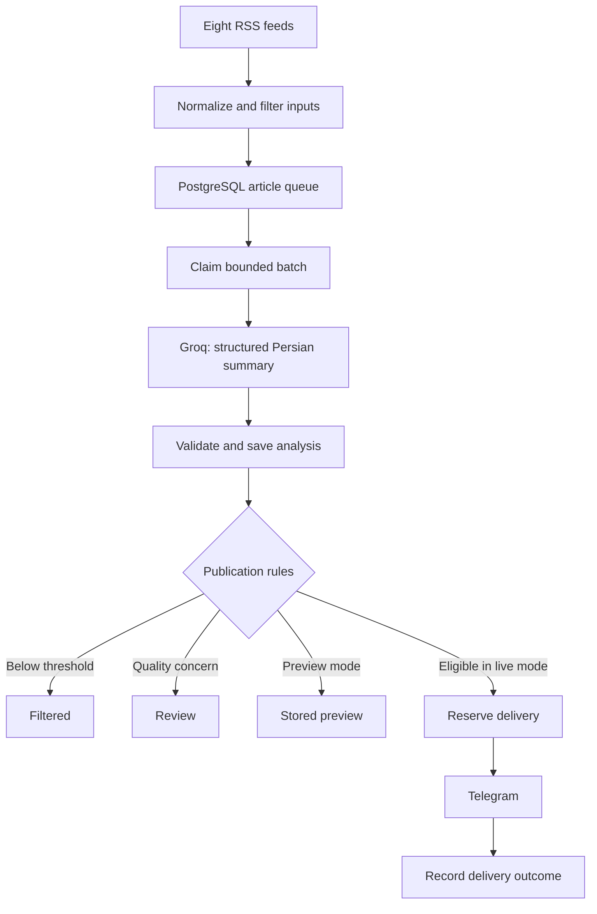

# Financial News Automation

**A scheduled news pipeline that turns financial RSS feeds into Persian Telegram briefings—with PostgreSQL tracking every processing and delivery outcome.**

Built with **n8n · PostgreSQL · Groq · JavaScript · Telegram Bot API**  
Developed by [Amin Sharifi](https://github.com/UniqueyII)

[Architecture](docs/architecture.md) · [Setup](docs/setup.md) · [Validation](docs/testing.md) · [راهنمای فارسی](docs/README.fa.md)

## Overview

Monitoring multiple news sources requires more than summarizing headlines: irrelevant stories, repeated URLs, incomplete excerpts, model output errors and uncertain delivery all need explicit handling.

This project implements that workflow end to end. It collects articles from eight feeds, applies input-quality checks, selects a bounded processing batch, generates structured Persian summaries and publishes items that meet configured quality thresholds. PostgreSQL stores article state, analysis attempts and Telegram delivery identifiers so each outcome can be inspected.

The current version has been demonstrated locally with live source ingestion, model inference and Telegram delivery. The shared workflows start inactive and in preview mode.

## How it works



1. **Ingest:** read Fed Monetary, ECB Press, Northern Miner Gold, Northern Miner Silver, Cointelegraph, FXStreet, BBC World and Al Jazeera feeds; record source health.
2. **Prepare:** normalize article fields, reject insufficient content and apply relevance rules before model inference. A unique URL prevents duplicate article insertion.
3. **Claim:** select eligible articles using queue ownership and `FOR UPDATE SKIP LOCKED`. Configured limits bound the number of model calls per run.
4. **Analyze:** request a Persian title, summary, importance score, confidence and supported market-impact observations as structured output.
5. **Validate:** check output structure, evidence quotes and numeric consistency; save the result and route the article to its next state.
6. **Deliver:** reserve an eligible article before sending, then store the Telegram message ID and final status. A separate manual workflow publishes explicitly selected previews.

## Engineering decisions

| Concern | Implementation |
|---|---|
| Repeated ingestion | Unique article URLs in PostgreSQL |
| Queue coordination | Row locking, execution ownership and conditional state transitions |
| Inference cost | Input filtering, batch limits and an inter-article pause |
| Output quality | Structured parsing, evidence matching, numeric checks and review routing |
| Controlled publication | Preview mode, configurable thresholds and a separate manual publisher |
| Duplicate-send risk | Conditional delivery reservation; confirmed sent records are excluded from resend |
| Ambiguous delivery | `send_unknown` records require reconciliation rather than a blind retry |
| Traceability | Article states, analysis attempts, source health and delivery identifiers |

These controls make failures visible. They do not provide an exactly-once guarantee across PostgreSQL and Telegram.

## Demonstrated execution

One recorded local execution produced the following result:

| Measure | Observed result |
|---|---:|
| Articles processed | 15 |
| Published | 1 |
| Filtered | 13 |
| Routed to review | 1 |
| Feed warnings | 0 |
| Tokens displayed by n8n | 27,201 |
| Elapsed time | Approximately 18 minutes |

The manual publishing workflow was also rerun after a successful send without sending the same article again. These are observations from the author's local setup, not throughput benchmarks or an accuracy evaluation. Elapsed time includes configured pauses between articles.

Publication is selective: an execution can complete successfully without sending a message when no article qualifies.

## Getting started

**Requirements:** n8n, PostgreSQL, a Groq API credential and a Telegram bot with permission to post to the destination. Node.js is needed only for the offline checks.

1. Apply [`database/schema.sql`](database/schema.sql) to a dedicated PostgreSQL database.
2. Import [`workflows/financial-news.json`](workflows/financial-news.json) into n8n.
3. Assign PostgreSQL, Groq and Telegram credentials through n8n's credential store. Set the destination chat ID in `Config`.
4. Keep `dryRun: true` and `autoPublish: false`, then run the workflow manually and inspect its stored output.
5. Follow the [setup guide](docs/setup.md) to enable live publication and scheduling, or use [`reviewed-publisher.json`](workflows/reviewed-publisher.json) for an explicitly reviewed preview.

Credentials are excluded from the exports. Switching to live mode does not automatically release existing preview or review records.

### Default configuration

| Parameter | Default |
|---|---|
| Model | `openai/gpt-oss-20b` via Groq |
| Processing batch | Up to 15 eligible articles |
| Ingestion cap | Up to 20 accepted articles per source |
| Lookback window | 36 hours |
| Minimum importance | 4 / 5 |
| Minimum model-reported confidence | 0.75 |
| Inter-article pause | 70 seconds |
| Schedule | Daily at 07:30, `Asia/Tehran` |
| Export mode | Inactive; preview enabled; placeholder chat ID |

Scheduling requires the workflow to be published/activated and the host services to remain running. Preview runs also consume model tokens.

## Validation

Run the offline checks from the repository root:

```bash
node tests/check-workflows.js
```

The packaged version passes **96 assertions**, including credential-reference removal, connection targets, preview defaults, formatter routing and delivery-result handling. All Code nodes are compiled for syntax checking.

These checks do not execute PostgreSQL queries or contact external APIs. Live observations, test scope and unverified scenarios are documented in [`docs/testing.md`](docs/testing.md).

## Repository guide

| Path | Contents |
|---|---|
| [`workflows/`](workflows/) | Main automation and manual preview publisher |
| [`database/`](database/) | Schema and read-only inspection queries |
| [`tests/`](tests/) | Offline workflow checks |
| [`docs/setup.md`](docs/setup.md) | Credentials, configuration and operating instructions |
| [`docs/architecture.md`](docs/architecture.md) | Queue design, states and delivery behavior |
| [`docs/testing.md`](docs/testing.md) | Validation evidence and scope |
| [`docs/demo-and-resume.md`](docs/demo-and-resume.md) | Recording guide and project presentation material |

## Operating boundaries

- **Source scope:** analysis uses titles and RSS excerpts, not full articles. Sparse excerpts can be rejected; source errors are surfaced through feed-health reporting.
- **Model reliability:** confidence is self-reported, not a calibrated probability. Evidence and numeric checks reduce some errors but do not establish factual truth or validate every market inference.
- **Deduplication:** URL uniqueness prevents repeat processing of the same URL; different articles covering the same event can still be published.
- **Delivery recovery:** a crash after Telegram accepts a message but before PostgreSQL records it requires reconciliation. Do not blindly resend uncertain deliveries.
- **Deployment:** the demonstrated installation is local. Continuous availability, load behavior and backup restoration have not been validated for a production deployment.

## License

Project code is available under the [MIT License](LICENSE). Third-party news content and services retain their respective terms and rights.
