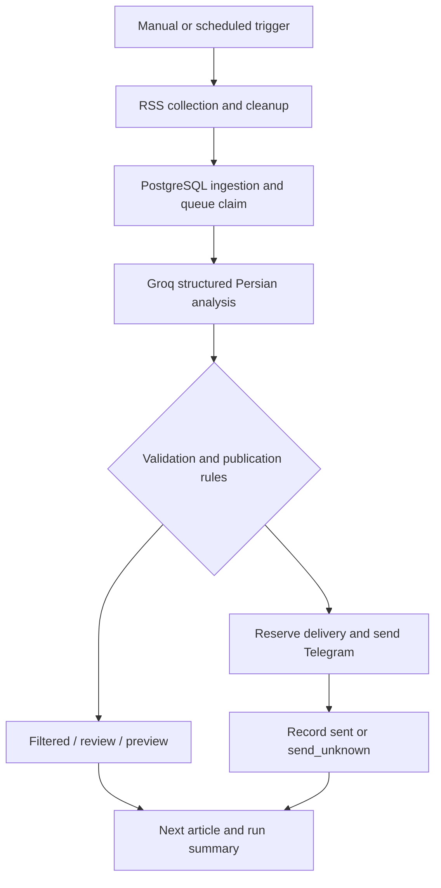

# Architecture

## Ingestion

Sources: Federal Reserve monetary releases, ECB press, Northern Miner Gold and Silver, Cointelegraph, FXStreet, BBC World and Al Jazeera. Feed nodes run sequentially once per workflow invocation. Normalization selects usable text from several RSS fields, requires at least 80 characters and 10 words, excludes placeholders and keeps at most 1,800 characters. General news sources require finance keywords. Specialist sources receive queue priority; general sources can be delayed by a persistent specialist backlog.

## Persistence

| Table | Purpose |
|---|---|
| articles | Unique URL, source text, current status, analysis, message and delivery metadata |
| runs | Ingestion execution ID, source health and accepted article count |
| analysis_attempts | Per-attempt analysis/error and model/prompt metadata |
| approval_log | Reserved schema capability; these exports do not write a formal approval audit |

`runs.article_count` is an ingestion count, not Run Summary's processed count. The model chain does not always expose usage to downstream nodes, so database usage may be `{}` even when n8n displays token totals.

## State transitions

Queue eligibility includes queued, failed (within attempt limit), and stale processing rows. Claiming sets owner to the execution ID and increments attempts. Updates are guarded by owner/status. Validation applies score filtering first, then review/quality checks, then preview/live routing. A low-scoring article can therefore be filtered even when it also has quality flags.

In live mode: ready → sending → sent or send_unknown. Manual publisher: explicitly selected preview → sending → sent or send_unknown. Empty reservation output does not permit Telegram publication. Unknown deliveries are not automatically retried.

PostgreSQL row locking prevents simultaneous claims of the same eligible row, but stale recovery is a lease-like heuristic, not a distributed exactly-once protocol. No external search, full-page retrieval, fact-checking, or trading action is performed.
